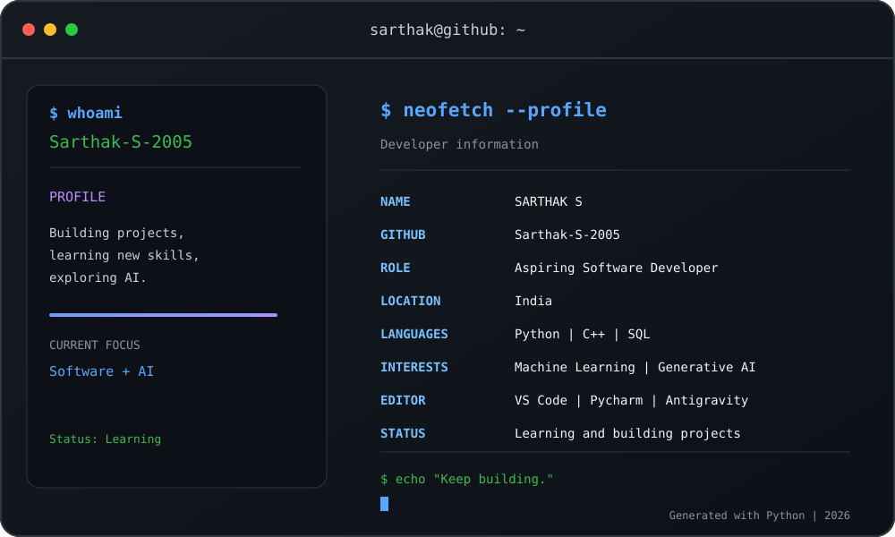
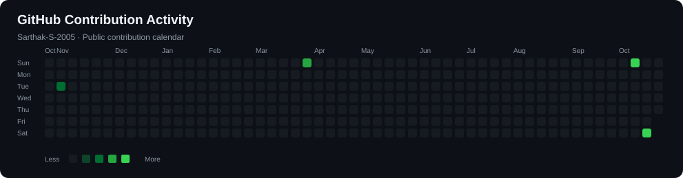

# Hey there, I'm Sarthak S 👋

### Aspiring Software Developer | AI & Machine Learning Enthusiast

  

  

---

## 👨‍💻 About Me

- 🎓 Engineering student at Dr. Ambedkar Institute of Technology.
- 💻 Interested in software development, machine learning, and Generative AI.
- 🌱 Continuously learning Python, SQL, and AI technologies.
- 🛠️ Building projects to turn ideas into practical solutions.
- 🎯 Focused on improving my programming and problem-solving skills.

## 🧰 Tech Stack

  

## 📊 GitHub Contribution Activity

  

## 🤝 Connect With Me

  
  

---

  <i>"Keep learning, keep building, and keep growing."</i>

